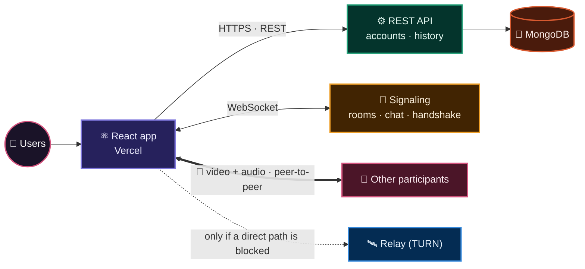
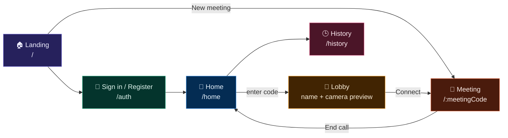
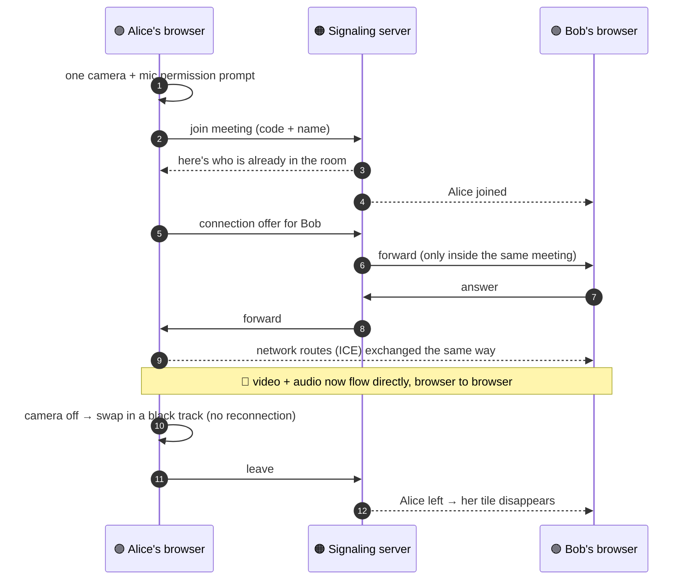

<div align="center">


<br/>



<br/><br/>



<br/><br/>

<a href="https://video-call-web-rtc-roan.vercel.app"></a>

<br/><br/>


<br/>


<br/><br/>

<a href="#features">✨ Features</a> •
<a href="#numbers">📊 Numbers</a> •
<a href="#stack">🧰 Stack</a> •
<a href="#architecture">🏗️ Architecture</a> •
<a href="#flow">🔄 Flow</a> •
<a href="#work">🛠️ Work done</a> •
<a href="#structure">🗂️ Structure</a> •
<a href="#frontend">⚛️ Frontend</a> •
<a href="#backend">⚙️ Backend</a> •
<a href="#tradeoffs">⚖️ Trade-offs</a> •
<a href="#roadmap">🗺️ Roadmap</a> •
<a href="#run">🚀 Run it</a>

</div>


> A full-stack, real-time **video conferencing** app: register, create or join a meeting, talk face to face with several people, share your screen and chat — all in the browser, with **video and audio flowing directly between participants** (peer-to-peer) instead of through a media server.

<a id="features"></a>

## ✨ Features

| | Feature | What it does |
| :-: | :-- | :-- |
| 🎥 | **Group video calls** | Multi-person calls in a mesh — every participant connects directly to every other one |
| 🖥️ | **Screen sharing** | Share a screen or window in one click; the camera comes back automatically when sharing stops |
| 🎙️ | **Instant mute / camera off** | Toggles swap tracks in place — no reconnection, the camera light really turns off |
| 💬 | **Live chat** | In-call messages for everyone in the room; late joiners receive the recent history |
| 🔔 | **Unread badge** | Chat icon shows how many messages you haven't read |
| 👥 | **Participants panel** | Live list of everyone in the meeting, with names |
| 🔐 | **Accounts** | Register and sign in; passwords stored as bcrypt hashes |
| 🕒 | **Meeting history** | Every meeting you joined, with its code and date |
| 🔗 | **Shareable links** | One click creates an unguessable meeting link |
| 🚪 | **Clean exit** | Leaving closes every connection and releases camera and mic immediately |
| 📱 | **Responsive UI** | Dark glass-style design across desktop, tablet and mobile |

<a id="numbers"></a>

## 📊 By the numbers

<div align="center">


<br/>


<br/>


</div>

| Metric | Value | Where it comes from |
| :-- | :-- | :-- |
| Peer connections in a 6-person call | **15** (6 × 5 ÷ 2) — 30 one-way streams | mesh topology math |
| Renegotiations when camera / screen changes | **0** | tested with a real WebRTC engine (3-person call, 5/5 runs connected) |
| Possible meeting codes | **36⁸ ≈ 2.8 trillion** | `xxxx-xxxx`, 36 characters, cryptographic randomness |
| Camera / mic permission calls on join | **3 → 1** | single `getUserMedia` request |
| Chat limits | **1,000** chars per message · last **200** messages per room | deleted when the room empties |
| Password hashing | bcrypt, **10** salt rounds | `user.controller.js` |
| Session token | **20** random bytes (hex) | `crypto.randomBytes` |
| Request body limit | **40 KB** | Express JSON parser |

<a id="stack"></a>

## 🧰 Tech stack

<div align="center">

</div>

| 🎨 Frontend | ⚡ Realtime | ⚙️ Backend | ☁️ Deploy |
| :-- | :-- | :-- | :-- |
| React 19 · Vite 7 · React Router 7 · Material UI 7 · Emotion · Axios · CSS Modules | WebRTC (browser API) · Socket.IO client + server · STUN / TURN relay | Node.js · Express 5 · Mongoose 8 · MongoDB Atlas · bcrypt · dotenv · CORS · http-status | Vercel (frontend) · Render (backend) · MongoDB Atlas · Vercel Speed Insights |

<details>
<summary>🎨 <b>Frontend — every library and why</b></summary>

<br/>

| Technology | Purpose |
| :-- | :-- |
| **React 19** | Component-based UI |
| **Vite 7** | Build tool + dev server with hot reload |
| **React Router DOM 7** | Client-side routing (`/`, `/auth`, `/home`, `/history`, `/:meetingCode`) |
| **Material UI 7** | Buttons, inputs, badges, icon buttons, snackbars |
| **Emotion** | CSS-in-JS engine used by MUI |
| **Axios** | HTTP client for the REST API |
| **Socket.IO Client** | Real-time channel for signaling and chat |
| **WebRTC** | Peer-to-peer video, audio and screen share |
| **CSS Modules** | Scoped styles for the meeting room |
| **Vercel Speed Insights** | Production performance monitoring |
</details>

<details>
<summary>⚙️ <b>Backend — every library and why</b></summary>

<br/>

| Technology | Purpose |
| :-- | :-- |
| **Node.js** | JavaScript runtime |
| **Express 5** | REST routing and middleware |
| **Socket.IO** | Rooms, signaling relay and chat broadcast |
| **MongoDB Atlas + Mongoose 8** | Users and meeting history |
| **bcrypt** | Password hashing (10 salt rounds) |
| **crypto** (built-in) | Random session tokens |
| **dotenv** | Environment variables from `.env` |
| **CORS** | Cross-origin requests from the frontend |
| **http-status** | Readable HTTP status constants |
| **nodemon** | Auto-restart in development |
</details>


<a id="architecture"></a>

## 🏗️ Architecture (high level)



**Key decisions**

- 🕸️ **Mesh topology** — every peer connects directly to every other peer: lowest latency and no media-server cost; best for small groups (2–6 people).
- 📡 **Socket.IO only for signaling and chat** — it introduces peers and relays their handshake; media never passes through the server.
- 🛰️ **Relay only as a fallback** — most calls connect directly; a TURN relay is used only when firewalls block a direct path. Its configuration is served by the backend, never hard-coded in the frontend.
- 🔑 **Opaque session tokens** — a random token stored in MongoDB (not JWT), so a new login replaces the old session.
- 📦 **Monorepo** — frontend and backend in one repository, one root `.env` for the backend.

<a id="flow"></a>

## 🔄 Application flow



### 🤝 What happens inside a call (plain language)



> If both browsers start the handshake at the same moment ("glare"), the **perfect negotiation** pattern decides which side backs off, so the call still connects.

<details>
<summary>🧭 <b>Step-by-step user journey</b></summary>

<br/>

1. **Landing (`/`)** — hero section; *New meeting* creates a secure random link, *Sign in / Register* goes to `/auth`.
2. **Authentication (`/auth`)** — toggle between Sign in and Sign up. Register hashes the password with bcrypt; login returns a session token stored in the browser.
3. **Home (`/home`, protected)** — enter a meeting code → it's saved to your history → you're taken to the meeting.
4. **Lobby** — type your display name and check your camera preview, then *Connect*.
5. **Meeting (`/:meetingCode`)** — peers connect automatically; controls for camera, mic, screen share, participants, chat and end call.
6. **History (`/history`)** — every meeting you joined, with code and date.
</details>


<a id="work"></a>

## 🛠️ Real work done

Problems found by auditing the original code, fixed and tested:

| # | Area | 🔴 Before | 🟢 After |
| :-: | :-- | :-- | :-- |
| 1 | **Secrets** | Relay (TURN) username and password hard-coded in frontend code | Served by the backend from environment variables, cached 10 min, safe fallback |
| 2 | **Leaving a call** | Socket and peer connections stayed open — you lingered as a frozen tile | Every connection closed, socket disconnected, camera and mic released — also when the page is left |
| 3 | **Server memory** | Every room's chat kept in RAM forever, no size limit | 1,000-char messages, last 200 per room, deleted when the room empties |
| 4 | **Signal isolation** | Any socket could send handshake messages to anyone | Forwarded only between two people in the **same** meeting |
| 5 | **Room identity** | Room = full browser URL (`?x=1` made a different room) | Room = the meeting code only |
| 6 | **Camera / mic / screen toggles** | Full renegotiation with every peer on each toggle | `replaceTrack` swap — **0** renegotiations |
| 7 | **Simultaneous offers** | Both sides offering at once could break the call | Perfect negotiation (polite / impolite peers + rollback) |
| 8 | **Deprecated APIs** | `addStream` / `onaddstream` | `addTrack` / `ontrack` |
| 9 | **Permissions** | 3 `getUserMedia` calls, 2 streams never stopped | 1 request, devices released correctly |
| 10 | **Meeting codes** | `Math.random` (predictable) | `crypto.getRandomValues` — ~2.8 trillion codes |
| 11 | **Early clicks** | Clicking *Connect* before allowing the camera left the call black; mic button did nothing | Call switches to the real camera and mic as soon as they're allowed |
| 12 | **Early network routes** | Routes arriving before the offer were rejected and lost | Queued and applied right after the offer |
| 13 | **Hygiene** | Junk packages (`i`, `npm`, server `socket.io` in frontend); chat names could be faked | Removed; sender name comes from the server |

<a id="structure"></a>

## 🗂️ Project structure

```text
video-call-webrtc/
├── .env                              # backend environment variables (never committed)
├── README.md
├── assets/                           # animated README graphics
│
├── backend/
│   ├── package.json
│   └── src/
│       ├── app.js                    # Express + Socket.IO server, MongoDB connection, routes
│       ├── controllers/
│       │   ├── user.controller.js    # register, login, meeting history
│       │   ├── socketManager.js      # rooms, signaling relay, chat, cleanup
│       │   └── turn.controller.js    # relay (TURN) configuration for WebRTC
│       ├── models/
│       │   ├── user.model.js         # name, username, password hash, token
│       │   └── meeting.model.js      # user, meeting code, date
│       └── routes/
│           └── users.routes.js       # REST routes
│
└── frontend/
    ├── package.json · vite.config.js · index.html · vercel.json
    ├── public/                       # background and illustration images
    └── src/
        ├── main.jsx · App.jsx        # entry point, router, auth provider, theme
        ├── App.css · index.css       # global styles
        ├── environment.js            # backend URL for dev / production
        ├── contexts/AuthContext.jsx  # auth state + API calls
        ├── utils/withAuth.jsx        # route-protection HOC
        ├── shared-theme/             # MUI theme
        ├── pages/
        │   ├── landing.jsx           # landing page + secure "New meeting"
        │   ├── authentication.jsx    # sign in / sign up
        │   ├── home.jsx              # join a meeting
        │   ├── history.jsx           # past meetings
        │   └── VideoMeet.jsx         # the call engine: WebRTC, signaling, chat, controls
        └── styles/                   # landing + meeting room styles (CSS Modules)
```

<a id="frontend"></a>

## ⚛️ Frontend deep dive

| Path | Page | Protected | Purpose |
| :-- | :-- | :-: | :-- |
| `/` | `landing.jsx` | — | Landing page, *New meeting* |
| `/auth` | `authentication.jsx` | — | Sign in / Register |
| `/home` | `home.jsx` | ✅ `withAuth` | Join a meeting by code |
| `/history` | `history.jsx` | data needs a token | Past meetings |
| `/:meetingCode` | `VideoMeet.jsx` | — | Lobby + meeting room |

<details>
<summary>🎥 <b>How the call engine (<code>VideoMeet.jsx</code>) works</b></summary>

<br/>

1. **Mount** — one camera + mic request; if one device is blocked, the other still works.
2. **Lobby** — name input and live camera preview.
3. **Connect** — fetches relay configuration from the backend, opens the socket, joins the room named by the meeting code.
4. **Peers** — one `RTCPeerConnection` per participant, kept in a React ref; each always sends **1 video + 1 audio track**.
5. **Handshake** — perfect negotiation (polite / impolite), early network routes queued until the offer arrives.
6. **Controls** — camera and screen share swap the outgoing video track with `replaceTrack`; mic toggles `track.enabled`; a black / silent placeholder is sent when a device is off.
7. **Chat** — sent over the socket, unread badge when the panel is closed.
8. **Cleanup** — `leaveCall()` closes peers, disconnects the socket and stops all tracks — on *End call* and whenever the page is left.
</details>

<details>
<summary>🧠 <b>State, auth and theming</b></summary>

<br/>

- **React Context (`AuthContext`)** — `handleLogin`, `handleRegister`, `addToUserHistory`, `getHistoryOfuser` for every page.
- **localStorage** — keeps the session token.
- **`useRef` vs `useState`** — peer connections, socket and media tracks live in refs (no re-render); UI state (tiles, chat, toggles) lives in state.
- **`withAuth` HOC** — redirects to `/auth` when no token is present; wraps the Home page.
- **MUI theme** — custom palette through `ThemeProvider`; the dark look comes from custom CSS.
</details>

<a id="backend"></a>

## ⚙️ Backend deep dive

| Part | Responsibility |
| :-- | :-- |
| `app.js` | Loads `.env`, sets up CORS and a 40 KB JSON limit, mounts REST routes and the relay-config route, attaches Socket.IO, connects to MongoDB, then starts listening |
| `socketManager.js` | In-memory rooms: `connections` (code → sockets), `roomOf` (socket → code, O(1)), `messages` (capped chat), names; cleans everything up when a room empties |
| `user.controller.js` | Register, login, add to history, get history |
| `turn.controller.js` | Returns STUN / TURN servers from the provider using a server-side key; cached 10 min; falls back to public STUN |

### 📨 Realtime events

| Event | Direction | Purpose |
| :-- | :-- | :-- |
| `join-call` | client → server | Join a room by meeting code and name; receive recent chat |
| `user-joined` | server → room | Someone joined (with the current member list) |
| `signal` | client → server → client | Handshake and network routes — only within the same meeting |
| `chat-message` | client → server → room | Chat (≤ 1,000 chars; sender name set by the server) |
| `participants` | server → room | Updated participant list |
| `user-left` | server → room | Someone left — remove their tile |

### 📡 REST API

| Method | Endpoint | Body / query | Purpose |
| :-- | :-- | :-- | :-- |
| `POST` | `/api/v1/users/register` | `name, username, password` | Create an account |
| `POST` | `/api/v1/users/login` | `username, password` | Sign in → session token |
| `POST` | `/api/v1/users/add_to_activity` | `token, meeting_code` | Save a meeting to history |
| `GET` | `/api/v1/users/get_all_activity` | `token` | List past meetings |
| `GET` | `/api/v1/ice-servers` | — | Relay configuration for WebRTC |

<details>
<summary>🗄️ <b>Database schema</b></summary>

<br/>

```javascript
// User
{
  name:     { type: String, required: true },               // display name
  username: { type: String, required: true, unique: true }, // login id
  password: { type: String, required: true },               // bcrypt hash
  token:    { type: String }                                // current session token
}

// Meeting
{
  user_id:     { type: String },                            // username
  meetingCode: { type: String, required: true },
  date:        { type: Date, default: Date.now, required: true }
}
```
</details>

<details>
<summary>🔐 <b>Authentication flow</b></summary>

<br/>

```text
Register  →  username free?  →  bcrypt.hash(password, 10)  →  save user  →  201
Login     →  find user  →  bcrypt.compare  →  crypto.randomBytes(20) token  →  save on user  →  return token
Client    →  store token  →  open /home (withAuth checks the token)
History   →  token sent with the request  →  server finds the user  →  returns meetings
```

Not JWT: the token is a random string stored in the database, so each new login replaces the previous session.
</details>


<a id="tradeoffs"></a>

## ⚖️ Trade-offs

| 🟢 Chose | ⚪ Over | ✅ Gained | ⚠️ Gave up |
| :-- | :-- | :-- | :-- |
| **Peer-to-peer mesh** | Media server (SFU / MCU) | Lowest latency, ₹0 media infrastructure | Each person uploads N−1 streams → best for ~4–6 people |
| **Socket.IO** | Raw WebSocket | Rooms, auto-reconnect, long-polling fallback | Heavier protocol |
| **Chat over the socket** | WebRTC DataChannel | History for late joiners, simple broadcast | Server sees chat (TLS only, not end-to-end) |
| **`replaceTrack` + placeholders** | Renegotiate on every toggle | Instant toggles, no glare | Screen-share audio not sent |
| **Perfect negotiation** | "Newcomer always offers" | Survives simultaneous offers | Slightly more state per peer |
| **Relay config from backend** | Hard-coded credentials | No secrets in frontend, easy rotation | One extra request when joining |
| **Opaque DB token** | JWT | Instant revocation on re-login | DB lookup per request |
| **In-memory rooms** | Redis | Zero infrastructure | Single server instance; restart ends calls |

<details>
<summary>🚧 <b>Known limitations (honest)</b></summary>

<br/>

- Mesh topology is practical for small groups only.
- Rooms live in server memory: one backend instance, and a restart ends active calls.
- Session tokens have no expiry and history requests send the token as a query parameter.
- Socket connections and the history page aren't guarded by authentication.
- No automatic reconnection (ICE restart) if the network changes mid-call.
</details>

<a id="roadmap"></a>

## 🗺️ Roadmap

- [ ] 🧩 **SFU media server** (mediasoup / LiveKit) + simulcast for 10+ participants
- [ ] 📝 **Live captions + AI meeting summary** (speech-to-text → summary and action items)
- [ ] 🗣️ **Active speaker highlight** using audio levels
- [ ] 📶 **Connection-quality indicator + auto-reconnect** (`getStats()`, ICE restart)
- [ ] 👑 **Host controls & waiting room** — admit, mute, remove, lock room
- [ ] 🌫️ **Background blur** (in-browser segmentation)
- [ ] ⏺️ **Recording** with `MediaRecorder`
- [ ] 🔑 **Token expiry + authenticated sockets**
- [ ] 🧪 **Automated tests** — socket server tests and browser call tests


<a id="run"></a>

## 🚀 Run it locally

<details>
<summary>⚙️ <b>Setup (≈ 10 minutes)</b></summary>

<br/>

**Needs:** Node.js 18+, a MongoDB Atlas database, a TURN relay account (optional — calls fall back to STUN).

```bash
git clone https://github.com/Aditya09Goyal/Video-Call-WebRTC.git
cd Video-Call-WebRTC
```

Create **`.env` in the project root** (next to this README):

```env
DB_USER=your_db_username
DB_PASSWORD=your_db_password
DB_CLUSTER=your_cluster_host/your_db_name
METERED_DOMAIN=your_relay_domain        # optional
METERED_API_KEY=your_relay_api_key      # optional, backend only
# DNS_SERVERS=8.8.8.8,1.1.1.1           # optional: only if MongoDB DNS lookups time out locally
```

**Backend**

```bash
cd backend
npm install
npm run dev          # http://localhost:8080
```

**Frontend** (new terminal)

```bash
cd frontend
npm install
npm run dev          # http://localhost:5173
```

Open the app in two windows (one normal, one private), join the same meeting link, and start talking.
</details>

<details>
<summary>☁️ <b>Deployment</b></summary>

<br/>

| Part | Platform | Notes |
| :-- | :-- | :-- |
| ⚛️ Frontend | Vercel | Vite build; set the production backend URL in `environment.js` |
| ⚙️ Backend | Render | Add the same variables as `.env` in the dashboard |
| 🍃 Database | MongoDB Atlas | Allow the backend's network access |

Push to `main` → both redeploy automatically.
</details>

## 👤 Author

**Aditya Goyal** — designed, built and maintains this project solo · [@Aditya09Goyal](https://github.com/Aditya09Goyal)

<div align="center">


</div>
